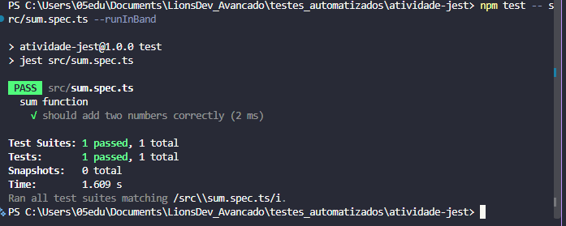
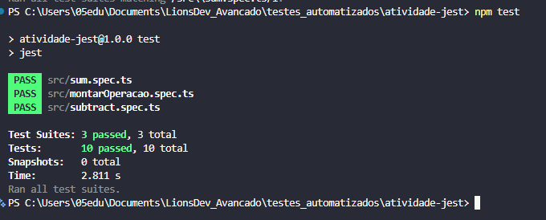

# Atividades práticas: testes automatizados com Jest

## Atividade 1

### Passo 1: tipos de teste

| Item | Tipo | Por quê? |
|---|---|---|
| a | Unitário | Verifica o resultado de `calcularFrete()` isoladamente. |
| b | Integração | Confere a comunicação entre o serviço de pedidos e o banco de dados. |
| c | End-to-end | Percorre a compra completa como o usuário faria no site. |
| d | Integração | Confere a comunicação do sistema de compras com o serviço de e-mail por HTTP. |
| e | Unitário | Verifica o cálculo de `aplicarCupom()` isoladamente. |
| f | Integração | Testa a rota HTTP junto com o código que cria e devolve o pedido. |

### Passo 2: pirâmide de testes

| Nível | Tipo de teste | Quantidade relativa | Custo |
|---|---|---|---|
| Topo | End-to-end | Poucos | Alto |
| Meio | Integração | Quantidade intermediária | Médio |
| Base | Unitários | Muitos | Baixo |

A base é mais larga porque os testes unitários são rápidos e baratos. Eles permitem verificar muitos comportamentos com frequência. Os testes de ponta a ponta cobrem fluxos importantes, mas custam mais tempo e manutenção.

### Passo 3: respostas

1. Testes automatizados são verificações executadas por um programa, que compara resultados obtidos com resultados esperados. Em um teste manual, uma pessoa executa os passos e confere o resultado.
2. Uma regressão acontece quando uma mudança quebra algo que funcionava antes. Executar os testes após cada mudança ajuda a encontrar esse problema cedo.
3. Em uma orquestra, testar um músico tocando sozinho se parece com um teste unitário. Testar se dois ou mais músicos tocam juntos no tempo certo se parece com um teste de integração.
4. Dois benefícios são encontrar erros mais cedo e dar segurança para alterar o código.
5. A qualidade faz parte do processo porque o comportamento do sistema precisa ser verificado durante o desenvolvimento, a cada mudança, e não somente no fim.

### Passo 4: caso do cupom

- Um teste unitário de `aplicarCupom()` ou do cálculo do total com cupom teria encontrado primeiro a diferença no resultado esperado.
- Esse teste deveria rodar durante a alteração e novamente antes de integrar a mudança ao projeto.
- Além de corrigir o defeito, a equipe deve acrescentar um teste que reproduza o caso do cupom para evitar a mesma regressão.

## Atividade 2

Na atividade 2, os arquivos `sum.ts` e `sum.spec.ts` foram colocados juntos em `src` para facilitar encontrar o teste de cada função. Na continuação, o exercício 5 reorganizou todos os testes em `src/__tests__`. O projeto usa `testEnvironment: 'node'` em `jest.config.js`.

### Perguntas

1. `ts-jest` transforma o TypeScript dos testes e do código para que o Jest consiga executá-los.
2. `node` é o ambiente adequado porque estas funções não usam navegador ou DOM. `jsdom` simula recursos de navegador.
3. Em `__tests__`, os testes ficam agrupados em uma pasta. Com `.spec.ts` ao lado da função, o código e seu teste ficam próximos. O Jest reconhece as duas convenções.
4. Um arquivo chamado apenas `sum.ts` não é identificado automaticamente como teste pelo Jest. Se contiver código de teste, esse código não será executado como suíte.

### Saída do teste da soma

Comando da atividade original: `npm test -- src/sum.spec.ts --runInBand`. O teste está atualmente em `src/__tests__/sum.spec.ts`, conforme a reorganização do exercício 5.



## Atividade 3

`subtract.ts` implementa a subtração com parâmetros e retorno tipados. Os cinco casos pedidos estão em `subtract.spec.ts`. Em cada teste, os dados são preparados, a função é executada e o resultado é verificado, seguindo Arrange, Act e Assert. As três etapas são separadas por linhas em branco.

`montarOperacao.ts` devolve um objeto com `operacao`, `valores` e `resultado`. Seus testes usam `toBe` para texto exato, `toEqual` para o objeto, `toContain` para um item do array e `toBeTruthy` para confirmar que o objeto existe. `toBeNull` não se aplica a esses resultados, pois nenhum campo tem valor nulo.

### Saída da suíte completa

Comando executado: `npm test`



### Resultado das atividades 2 e 3

As atividades 2 e 3 resultaram em três suítes e dez testes aprovados no Jest.

## Exercício 4: testando erros

A função `divide` foi criada em `src/divide.ts`. Ela divide os dois números e lança `Error('divisão por zero')` quando o divisor é zero. Os seis cenários pedidos estão cobertos em `src/__tests__/divide.spec.ts`.

### Comparação das quatro variações

| Verificação | O que exige |
|---|---|
| `toThrow()` | Que algum erro seja lançado. |
| `toThrow('divisão por zero')` | Que a mensagem do erro contenha esse texto. |
| `toThrow(/zero/)` | Que a mensagem corresponda à expressão regular. |
| `toThrow(Error)` | Que o erro seja uma instância de `Error`. |

As quatro variações estão em testes separados. A verificação da mensagem é a que melhor identifica o motivo esperado neste exemplo. O teste com `Error` confirma o tipo, mas ainda aceita outros erros desse mesmo tipo.

### Respostas

1. O `expect` precisa receber uma função para o Jest controlar a chamada e capturar o erro. Se escrevermos `expect(divide(10, 0))`, a divisão será executada e lançará o erro antes de o `expect` recebê-la.
2. Se a função não lançar erro e o teste usar `toThrow`, o teste falha.
3. Verificar a mensagem ajuda a confirmar que o erro aconteceu pelo motivo esperado. Verificar apenas se houve erro poderia aceitar uma falha diferente.
4. Usaria `not.toThrow` para confirmar que uma entrada válida não provoca erro, como `divide(10, 5)`.

A execução apenas da divisão passou com nove testes: [saída do exercício 4](relatorios/testes-divide.txt).

## Exercício 5: estrutura de arquivos

Escolhi agrupar todos os testes em `src/__tests__`, mantendo a extensão `.spec.ts`. Agora o projeto tem mais funções, e uma pasta única facilita localizar suas suítes. O TypeScript e o `ts-jest` foram mantidos, como o enunciado permite.

```text
src/
  __tests__/
    api.spec.ts
    divide.spec.ts
    formatador.spec.ts
    montarOperacao.spec.ts
    subtract.spec.ts
    sum.spec.ts
    usuarioService.spec.ts
  app.ts
  divide.ts
  formatador.ts
  montarOperacao.ts
  server.ts
  subtract.ts
  sum.ts
  usuarioService.ts
```

Os imports dos testes usam `../` para alcançar o arquivo de produção. `formatarNome` retira os espaços das pontas, coloca as letras em minúsculas e transforma a primeira em maiúscula. Foram testadas as entradas `maria`, ` joão `, `ANA` e texto vazio.

O comando `npm test -- divide formatador --runInBand` aprovou as duas suítes deste exercício, com treze testes: [saída do exercício 5](relatorios/testes-estrutura.txt). A suíte completa tem sete arquivos de teste porque também inclui as atividades anteriores, a API e o serviço de usuários.

### Comandos do dia a dia

| Comando | Uso |
|---|---|
| `npm test -- --runInBand` | Executa todos os testes uma vez. |
| `npx jest --watch --runInBand` | Acompanha alterações e reexecuta os testes relacionados. |
| `npx jest divide --runInBand` | Executa apenas a suíte de divisão. |
| `npx jest --verbose --runInBand` | Mostra o nome de cada teste. |

Os comandos registrados utilizam `--runInBand` para executar os testes sequencialmente no mesmo processo.

A execução com `--verbose` está registrada em [saída detalhada dos testes](relatorios/testes-verbose.txt).

## Exercício 6: integração com API REST

O arquivo `app.ts` configura o Express e a rota `GET /ping`, que devolve `{ status: 'ok' }`. O arquivo `server.ts` inicia o servidor na porta 3000. Os testes importam somente o app e usam o Supertest para gerenciar as requisições HTTP temporárias.

Os quatro cenários foram testados: resposta 200 e corpo correto, cabeçalho JSON, rota inexistente com 404 e `POST /ping` com 404. Em todos os casos são verificados o status e o conteúdo da resposta. Para os erros 404, foi mantida a resposta HTML padrão do Express e verificado seu texto.

### Respostas

1. É um teste de integração porque verifica a requisição HTTP passando pelo Express, pela rota e pela criação da resposta, com esses componentes funcionando juntos.
2. Se `app.listen` estivesse dentro de `app.ts`, importar o app já abriria a porta 3000. Isso poderia causar conflito de porta e deixar um servidor aberto ao terminar os testes.
3. Usamos `toEqual` porque queremos comparar os campos do objeto. `toBe` compararia a referência do objeto, e dois objetos com o mesmo conteúdo podem ter referências diferentes.

## Exercício 7: simulando banco de dados

`criarUsuarioService` recebe um repositório e devolve o método `buscarUsuario`. O serviço retorna o resultado de `buscarPorId`, inclusive `null` quando o usuário não existe. A dependência aceita também uma promessa, permitindo usar o mesmo serviço com um repositório assíncrono.

Os cinco testes usam `jest.fn()`, `mockReturnValue`, `mockResolvedValue`, `toHaveBeenCalled`, `toHaveBeenCalledWith`, `toHaveBeenCalledTimes`, `toEqual` e `toBeNull`. O caso assíncrono usa `await`. Cada teste cria seu próprio mock, e `beforeEach` também chama `jest.clearAllMocks()` para limpar os históricos de chamadas.

### Respostas

1. Verificar o retorno confirma o resultado entregue ao chamador. Verificar a chamada confirma que o serviço consultou o repositório, com qual id e quantas vezes. As duas verificações observam aspectos diferentes do comportamento.
2. O serviço recebe o repositório para que possamos substituí-lo por um mock durante os testes. Assim, não precisamos conectar a um banco real.
3. O mock não garante que a consulta funciona em um banco real, que os dados são gravados corretamente ou que a conexão está configurada. Um teste de integração com o banco pode verificar essa comunicação.

`jest.clearAllMocks()` limpa as chamadas registradas, mas não apaga a implementação ou o retorno configurado do mock.

## Exercício 8: cobertura de código

### Medição antes e depois

A primeira medição foi feita antes de acrescentar o teste de texto vazio de `formatarNome` e antes de configurar o piso de cobertura. Todas as funções incluídas no relatório já tinham algum teste: oito funções foram executadas, contando a fábrica do serviço e seu método. Nenhuma função de produção incluída no cálculo estava completamente sem teste.

O arquivo com menor cobertura de ramos era `formatador.ts`, com 0% na medição gerada. A linha 5, que devolve texto vazio quando o nome está vazio, não tinha sido executada. Nesse arquivo, instruções e linhas estavam em 80%, e funções em 100%.

Acrescentei o teste `returns an empty name without throwing an error`, executei a cobertura novamente e obtive:

| Métrica global | Antes | Depois |
|---|---|---|
| Instruções | 96% | 100% |
| Ramos | 50% | 100% |
| Funções | 100% | 100% |
| Linhas | 96% | 100% |
| Testes aprovados | 31 | 32 |
| Suítes aprovadas | 7 | 7 |

Na medição final, todos os sete arquivos incluídos no relatório ficaram com 100% nas quatro métricas, sem linhas descobertas.

### Relatórios entregues

- [Relatório visual antes](relatorios/cobertura-antes/lcov-report/index.html).
- [Relatório visual depois](relatorios/cobertura-depois/lcov-report/index.html).
- [Saída do comando antes](relatorios/cobertura-antes.txt).
- [Saída do comando depois](relatorios/cobertura-depois.txt).
- [Resumo numérico antes](relatorios/cobertura-antes/coverage-summary.json).
- [Resumo numérico depois](relatorios/cobertura-depois/coverage-summary.json).

Em `formatador.ts`, o relatório inicial marca a linha 5 como não executada; o relatório final mostra essa linha coberta. Os relatórios HTML e seus arquivos de apoio foram gerados automaticamente pelo Jest.

O comando da primeira medição foi `npm test -- --coverage --runInBand --coverageDirectory=relatorios/cobertura-antes`. O comando final foi `npm test -- --coverage --runInBand`. O diretório padrão foi configurado como `relatorios/cobertura-depois` para preservar a medição inicial.

### Piso de cobertura

O arquivo `jest.config.js` exige no mínimo 80% de instruções, 70% de ramos, 80% de funções e 80% de linhas. Esses valores seguem a proposta do exercício e ajudam a detectar quedas importantes de cobertura neste projeto de aprendizado. A execução final passou com o piso habilitado.

O cálculo inclui os arquivos `.ts` de produção. Os testes e `server.ts` foram excluídos, pois o primeiro grupo contém as verificações, e o segundo apenas inicia o servidor. A aplicação e sua rota continuam incluídas por meio de `app.ts`.

### Respostas

1. Cobertura de instruções mede quais instruções foram executadas. Cobertura de ramos mede quais caminhos das decisões foram percorridos, como a condição de divisor zero e a de nome vazio.
2. Cem por cento de cobertura não significa ausência de defeitos porque executar uma linha não garante que o teste verificou corretamente seu resultado ou considerou todas as entradas relevantes.
3. A cobertura não aponta uma funcionalidade que deveria existir, mas não foi implementada, nem uma regra de negócio entendida de forma errada.
4. Excluir arquivos que apenas iniciam o programa, arquivos gerados e os próprios testes mantém o cálculo focado no código de produção que queremos verificar.
5. Para este projeto, definiria o piso de 80% de instruções, funções e linhas e 70% de ramos, mantendo a análise dos cenários junto com a métrica. O objetivo é evitar lacunas relevantes sem criar testes apenas para aumentar números.

## Resultado final

O comando `npm test -- --coverage --runInBand` aprovou as sete suítes e os 32 testes, com 100% de cobertura de instruções, ramos, funções e linhas nos arquivos incluídos no cálculo. A compilação TypeScript foi aprovada com `npm run build`.
