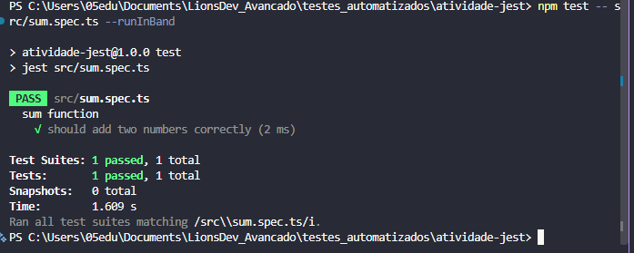
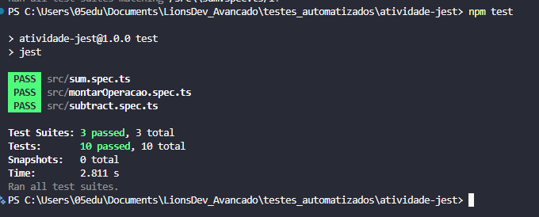

# Atividades práticas: testes automatizados com Jest

## Atividade 1

### Passo 1: tipos de teste

| Item | Tipo | Por quê? |
|---|---|---|
| a | Unitário | Verifica o resultado de `calcularFrete()` isoladamente. |
| b | Integração | Confere a comunicação entre o serviço de pedidos e o banco de dados. |
| c | End-to-end | Percorre a compra completa como o usuário faria no site. |
| d | Integração | Confere a comunicação do sistema de compras com o serviço de e-mail por HTTP. |
| e | Unitário | Verifica o cálculo de `aplicarCupom()` isoladamente. |
| f | Integração | Testa a rota HTTP junto com o código que cria e devolve o pedido. |

### Passo 2: pirâmide de testes

| Nível | Tipo de teste | Quantidade relativa | Custo |
|---|---|---|---|
| Topo | End-to-end | Poucos | Alto |
| Meio | Integração | Quantidade intermediária | Médio |
| Base | Unitários | Muitos | Baixo |

A base é mais larga porque os testes unitários são rápidos e baratos. Eles permitem verificar muitos comportamentos com frequência. Os testes de ponta a ponta cobrem fluxos importantes, mas custam mais tempo e manutenção.

### Passo 3: respostas

1. Testes automatizados são verificações executadas por um programa, que compara resultados obtidos com resultados esperados. Em um teste manual, uma pessoa executa os passos e confere o resultado.
2. Uma regressão acontece quando uma mudança quebra algo que funcionava antes. Executar os testes após cada mudança ajuda a encontrar esse problema cedo.
3. Em uma orquestra, testar um músico tocando sozinho se parece com um teste unitário. Testar se dois ou mais músicos tocam juntos no tempo certo se parece com um teste de integração.
4. Dois benefícios são encontrar erros mais cedo e dar segurança para alterar o código.
5. A qualidade faz parte do processo porque o comportamento do sistema precisa ser verificado durante o desenvolvimento, a cada mudança, e não somente no fim.

### Passo 4: caso do cupom

- Um teste unitário de `aplicarCupom()` ou do cálculo do total com cupom teria encontrado primeiro a diferença no resultado esperado.
- Esse teste deveria rodar durante a alteração e novamente antes de integrar a mudança ao projeto.
- Além de corrigir o defeito, a equipe deve acrescentar um teste que reproduza o caso do cupom para evitar a mesma regressão.

## Atividade 2

Os arquivos `sum.ts` e `sum.spec.ts` ficam juntos em `src`. Essa organização facilita encontrar o teste de cada função. O projeto usa `testEnvironment: 'node'` em `jest.config.js`.

### Perguntas

1. `ts-jest` transforma o TypeScript dos testes e do código para que o Jest consiga executá-los.
2. `node` é o ambiente adequado porque estas funções não usam navegador ou DOM. `jsdom` simula recursos de navegador.
3. Em `__tests__`, os testes ficam agrupados em uma pasta. Com `.spec.ts` ao lado da função, o código e seu teste ficam próximos. O Jest reconhece as duas convenções.
4. Um arquivo chamado apenas `sum.ts` não é identificado automaticamente como teste pelo Jest. Se contiver código de teste, esse código não será executado como suíte.

### Saída do teste da soma

Comando executado: `npm test -- src/sum.spec.ts --runInBand`



## Atividade 3

`subtract.ts` implementa a subtração com parâmetros e retorno tipados. Os cinco casos pedidos estão em `subtract.spec.ts`. Em cada teste, os dados são preparados, a função é executada e o resultado é verificado, seguindo Arrange, Act e Assert. Os comentários que nomeiam essas etapas no exemplo do enunciado foram substituídos por linhas em branco para respeitar a orientação de não incluir comentários no código.

`montarOperacao.ts` devolve um objeto com `operacao`, `valores` e `resultado`. Seus testes usam `toBe` para texto exato, `toEqual` para o objeto, `toContain` para um item do array e `toBeTruthy` para confirmar que o objeto existe. `toBeNull` não se aplica a esses resultados, pois nenhum campo tem valor nulo.

O desafio de `calcularFrete` foi deixado de fora por ser opcional.

### Saída da suíte completa

Comando executado: `npm test`



### Pendência para executar o Jest

O ambiente está sem acesso ao registro do npm. A tentativa de instalação retornou `ECONNREFUSED` ao acessar `https://registry.npmjs.org/@types%2fjest`; o cache local também não contém o pacote. Por isso, o Jest não foi instalado e não há saída de testes aprovados para copiar. `tsconfig.json` e `jest.config.js` foram escritos com as configurações indicadas no enunciado, pois os comandos `npx tsc --init` e `npx ts-jest config:init` dependem dos pacotes ausentes.

Quando houver acesso ao registro do npm, execute dentro de `atividade-jest`:

```bash
npm install --offline=false
npm test -- src/sum.spec.ts --runInBand
npm test
```

Depois, substitua as duas saídas acima pelas saídas reais dos testes aprovados. Para entregar, compacte esta pasta sem `node_modules`.

Como verificação parcial, as funções `sum` e `subtract` passaram em seis chamadas diretas com Node 22, e os três arquivos de implementação passaram pela verificação de tipos com TypeScript. Isso não substitui a execução da suíte Jest.
